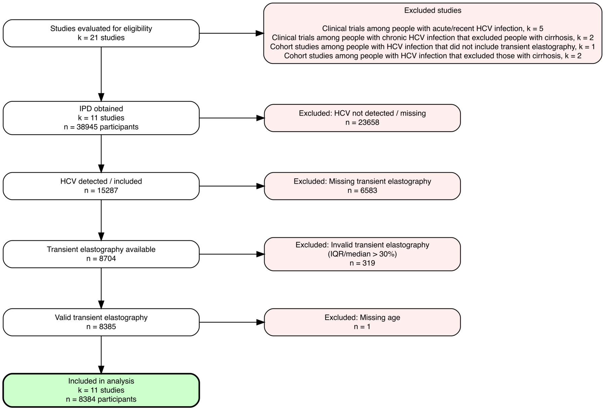
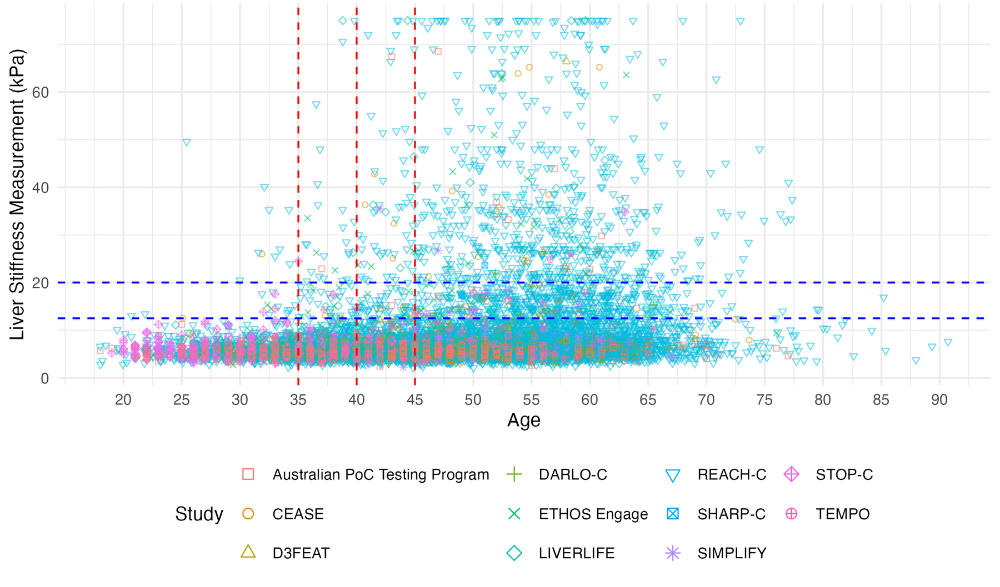
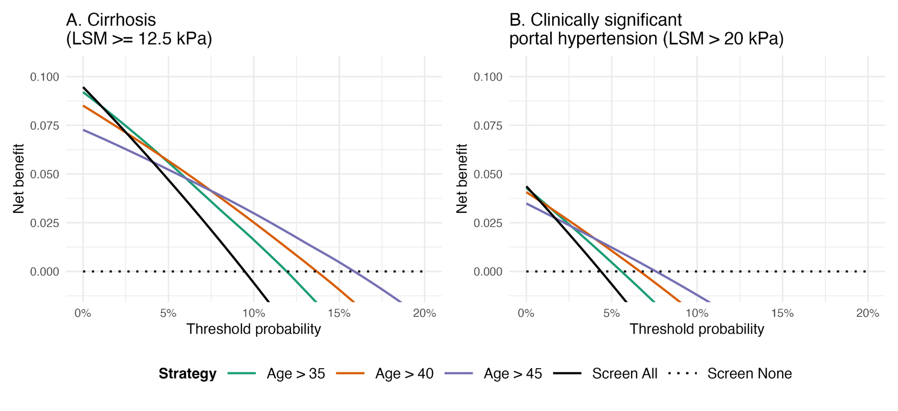
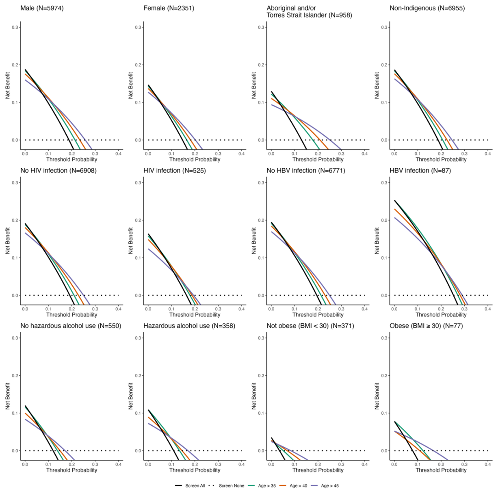
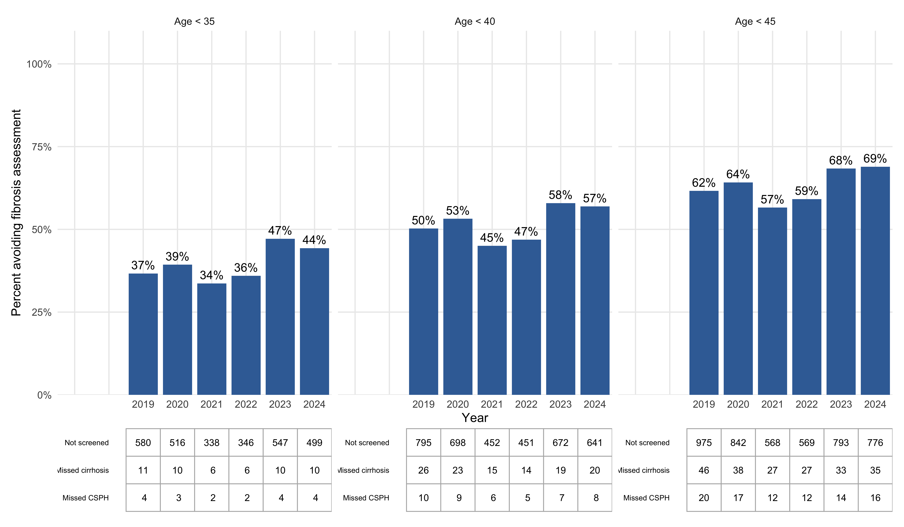

# Can age guide non-invasive fibrosis testing before hepatitis C treatment?

Code and manuscript figures for an individual participant data (IPD) meta-analysis and decision curve analysis of selective fibrosis assessment before hepatitis C treatment by Goodman-Meza and colleagues. A citation and link to the article will be added when it is published.

## Study at a glance

The analysis brings together 8,384 adults from 11 studies who had a liver stiffness measurement (LSM) before starting direct-acting antiviral treatment. It asks whether age can help decide who should receive pre-treatment fibrosis assessment when that assessment might delay treatment. Strategies based on age thresholds of **>35, >40, and >45 years** are compared with testing everyone and testing no one. The outcomes are cirrhosis (LSM ≥12.5 kPa) and clinically significant portal hypertension (CSPH; LSM >20 kPa).

The code also applies age-specific prevalence estimates to New South Wales (NSW) hepatitis C notification counts to illustrate the potential public health impact of each threshold. These are modelled estimates, not observed diagnoses missed in NSW.

The repository contains analysis code and manuscript figure files. The contributing-study IPD, harmonised datasets, source workbooks, PBS treatment data, and derived CSV tables are **not public** because access is governed by the data providers. The figures can be viewed without those inputs; rerunning the analyses requires authorised access to them.

## Manuscript figures

PNG previews are shown below so the figures display on GitHub. Each figure also has a linked EPS file for publication use.

### Figure 1. Study flow

The PRISMA-IPD diagram follows studies from eligibility assessment through IPD receipt and participant exclusions. It shows why participants were excluded after data were obtained and the final analytic cohort of 8,384 adults from 11 studies. Excluded studies are described by category rather than named individually.



[Download Figure 1 EPS](outputs/figures/Figure_1_600dpi.eps)

### Figure 2. Liver stiffness and age

Each mark represents a participant's LSM and age, with symbols distinguishing contributing studies. Blue horizontal lines mark the cirrhosis and CSPH LSM cutoffs; red vertical lines mark ages 35, 40, and 45 years. The plot shows why an age threshold changes the number of people referred for fibrosis assessment, while also showing that elevated LSM can occur at younger ages.



[Download Figure 2 EPS](outputs/figures/Figure_2_600dpi.eps)

### Figure 3. Overall decision curves

Panels A and B compare the pooled net benefit of the age-based strategies for cirrhosis and CSPH, respectively, with testing everyone or no one. The horizontal axis is the threshold probability: the risk at which assessment is considered worthwhile given its potential benefit and burden. At a given threshold, a higher curve indicates greater net benefit; the dotted horizontal line represents testing no one.



[Download Figure 3 EPS](outputs/figures/Figure_3_600dpi.eps)

### Figure 4. Cirrhosis decision curves by subgroup

The same age strategies are compared within subgroups defined by gender, Aboriginal and Torres Strait Islander identification, HIV, hepatitis B, hazardous alcohol use, and obesity. The panels show how net benefit varies across groups. Alcohol-use and obesity information was missing for 89% and 95% of participants, respectively, so those panels should be interpreted cautiously.



[Download Figure 4 EPS](outputs/figures/Figure_4_600dpi.eps)

### Figure 5. Projected impact in NSW, 2019–2024

For each year and age cutoff, the bars show the percentage of HCV notifications in the included 20–69-year age bands who would avoid baseline fibrosis assessment. The tables show estimated counts not assessed and estimated cases of cirrhosis and CSPH whose baseline identification would be deferred. The estimates apply age-specific prevalence from the IPD cohort to NSW notification counts; they are not a follow-up study of NSW patients.



[Download Figure 5 EPS](outputs/figures/Figure_5_600dpi.eps)

## Reproduce locally

Run the scripts from the repository root using R 4.5 or later. The scripts load their analysis packages through `pacman::p_load()`, which installs missing R packages. Install `pacman` and `knitr` first. Pandoc is needed only if you choose to render the R Markdown files as reports.

Create a local `Data/` directory and place only datasets you are authorised to use there. Git ignores `Data/` and the generated `Results/` directory. The merge script expects the following study CSVs (`ethos_harmonized.csv` and `reach_harmonized.csv` are accepted in place of the corresponding base files):

```text
Data/ethos.csv           Data/reach.csv          Data/defeat.csv
Data/simplify.csv        Data/sharp_c.csv        Data/stop_c.csv
Data/cease.csv           Data/darlo.csv          Data/liverlife.csv
Data/poct.csv            Data/tempo_rct.csv
```

`Data/scalec.csv` is read if available. Descriptive tables also require `Data/study_data.csv`, a separate study-level input. Figure 5 requires `Data/NSW_HCV_notifications_2019_2024_split_age_only.csv`. The optional PBS analyses require `Data/Get data/PBS HCV dataset_March2025.dta`, and the risk-of-bias analysis requires `Data/Risk of bias.xlsx`. The scripts expect the column names and coding used in the original analysis; the repository does not provide substitutes for these governed inputs.

| Step | What it produces |
| --- | --- |
| `01_merge_data.Rmd` | Harmonised participant files and study-flow counts |
| `01b_prisma_flow.Rmd` | Study-flow diagram and Figure 1 EPS |
| `02_descriptives.Rmd` | Cohort tables and descriptive plots underlying Figure 2 |
| `03_decision_curve_analysis.Rmd` | Cohort-level decision curve analyses |
| `04_decision_curve_subgroup_analysis.Rmd` | Cohort-level subgroup decision curves |
| `05_meta_analysis_dnb.Rmd` | Study-level meta-analysis and pooled decision curves underlying Figures 3–4 |
| `figure_5_rebuild.R` | Figure 5 EPS and PNG from cohort and NSW notification counts |

The following commands run the main workflow. The shell function extracts executable R from each R Markdown file and runs it; this is the path used to check the scripts. Run one command at a time so any missing input or package error is easy to locate.

```sh
Rscript -e 'install.packages(c("pacman", "knitr"), repos = "https://cloud.r-project.org")'

run_rmd() {
  Rscript -e 'f <- commandArgs(TRUE)[1]; p <- tempfile(fileext = ".R"); knitr::purl(f, output = p, quiet = TRUE); source(p, chdir = FALSE)' "$1"
}

run_rmd scripts/01_merge_data.Rmd
run_rmd scripts/01b_prisma_flow.Rmd
run_rmd scripts/02_descriptives.Rmd
run_rmd scripts/03_decision_curve_analysis.Rmd
run_rmd scripts/04_decision_curve_subgroup_analysis.Rmd
run_rmd scripts/05_meta_analysis_dnb.Rmd
Rscript scripts/figure_5_rebuild.R
```

`01_merge_data.Rmd` writes the harmonised cohort files to the private `Data/` directory and study-flow counts to `Results/Descriptives/`. The later scripts write tables and plots to `Results/`. `01b_prisma_flow.Rmd` regenerates Figure 1's EPS; `figure_5_rebuild.R` regenerates Figure 5's EPS and 600 dpi PNG. Figures 2–4 are provided as publication files; the analysis scripts generate their underlying descriptive and decision-curve plots under `Results/`, but do not export those exact EPS files.

Additional scripts cover integer-formatted descriptive tables (`02b_descriptives_integer.Rmd`), national PBS impact estimates (`06_pbs_national_impact.Rmd`), QUIPS risk-of-bias figures (`07_risk_of_bias_quips_robvis.Rmd`), APRI and FIB-4 analyses (`08_apri_fib4_prevalence.Rmd`), and exploratory NSW testing-versus-treatment plots (`09_nsw_impact_figure.R`). Run these only with their corresponding private inputs. Generated `Results/` files are local working outputs and are not committed.
